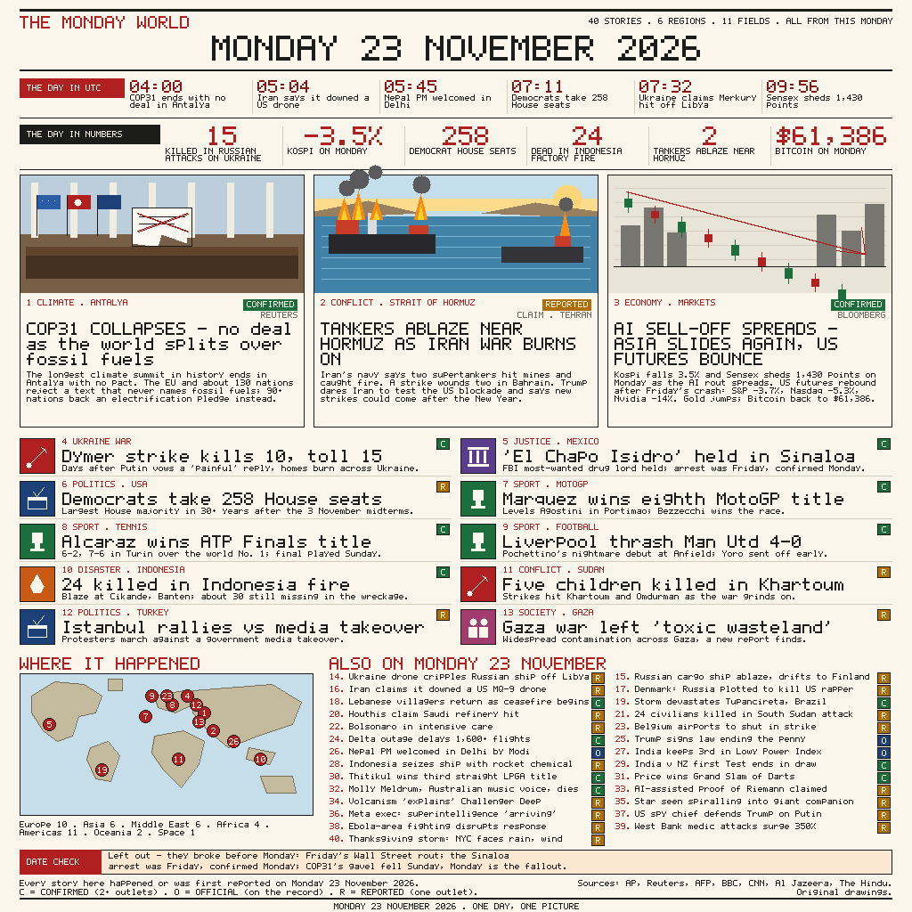

# The Monday World — 23 November 2026

[](https://make.fun/bounty/news-image-20261123?utm_source=github&utm_medium=readme&utm_campaign=news-image-20261123)
[](https://make.fun/bounty/news-image-20261123/leaderboard?utm_source=github&utm_medium=readme&utm_campaign=news-image-20261123)
[](https://make.fun/bounty/news-image-20261123?utm_source=github&utm_medium=readme&utm_campaign=news-image-20261123)

One page of world news from a single day — **Monday 23 November 2026** — drawn
entirely in code. Entry for the
[news-image-20261123](https://make.fun/bounty/news-image-20261123) bounty on
[make.fun](https://make.fun).



## What is on the page

**40 stories, all from this Monday.** Every story happened or was first reported
on Monday 23 November 2026, and every story carries a verification badge:

- **C = CONFIRMED** — reported by two or more outlets
- **O = OFFICIAL** — on the record (a signed law, an official welcome, an index)
- **R = REPORTED** — one outlet so far

Structure: 3 big lead stories with drawn illustrations (COP31 collapses in
Antalya; tankers ablaze near Hormuz; the AI sell-off spreads), 10 mid stories
with small field icons, and 27 more in the "Also on Monday 23 November" list.

Also on the page:

- **THE DAY IN UTC** — a timeline of the day with exact HH:MM timestamps.
- **THE DAY IN NUMBERS** — six big numbers: 15 killed in Russian attacks on
  Ukraine, Kospi -3.5%, 258 Democrat House seats, 24 dead in the Indonesia
  factory fire, 2 tankers ablaze near Hormuz, Bitcoin $61,386.
- **WHERE IT HAPPENED** — a world map with numbered pins and a region count:
  Europe 10 · Asia 6 · Middle East 6 · Africa 4 · Americas 11 · Oceania 2 ·
  Space 1.
- **DATE CHECK** — what was deliberately left out because it broke before
  Monday: Friday's Wall Street rout, the Friday arrest in Sinaloa (confirmed
  Monday), and COP31's Sunday gavel (Monday is the fallout).

## How it is made

`main.py` is pure Python standard library — no dependencies, no downloads.
It contains its own 5x7 bitmap font and its own PNG encoder, and it draws
everything: masthead, timeline, numbers, three lead illustrations, ten field
icons, the world map, and all 40 stories. Deterministic: two runs produce a
byte-identical `entry.png`.

```sh
python3 main.py          # writes entry.png to $MAKEFUN_OUTPUT_DIR or /output
```

Verified: two consecutive runs produce identical files
(`sha256 edd739b85990ec52503abedd5b54ffb774283cf9828588416b6d72aa611c6c3c`,
43,819 bytes, 1024x1024).

## Sources

AP, Reuters, AFP, BBC, CNN, Al Jazeera, The Hindu. Claims are attributed in
the text (for example "Iran's navy says", "Zelenskyy claims", "a new report
finds"); nothing is presented as fact when only one outlet carries it.
